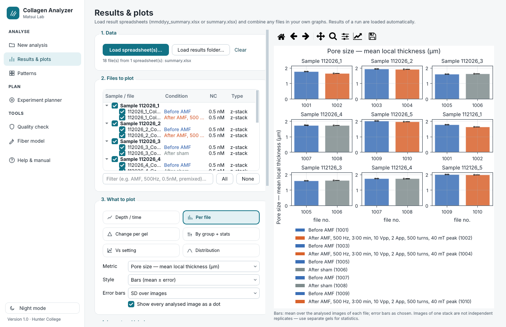

# Collagen Reflectance Analyzer

Desktop app for Mac and Windows that measures the structure of collagen hydrogels in confocal **reflectance** images
(`.nd2` from the Nikon A1, or `.tif`): fiber density, pore size, fiber thickness and length, alignment and patchiness.
It compares files before and after AMF treatment, across samples and across experiments, and makes figures and
spreadsheets ready for papers.

Matsui Lab · Hunter College (CUNY) · version 1.0



## Download and install (no Python needed)

1. Open **[Actions → Build app](../../actions/workflows/build.yml)**, click the latest successful (green) run and download
   from **Artifacts**. If a **[release](../../releases)** exists, download the zips from there instead.

   | Your computer | Download |
   |---|---|
   | Mac with M1/M2/M3/M4 chip (Apple menu → About This Mac → *Chip: Apple…*) | `CollagenAnalyzer-mac-apple-silicon` |
   | Older Mac with Intel processor | `CollagenAnalyzer-mac-intel` |
   | Windows 10 / 11 (64-bit) | `CollagenAnalyzer-windows` |

2. **Mac:** unzip until you see **Collagen Analyzer.app** (there may be a zip inside the zip), then drag it to **Applications**.
   The app is not signed by Apple, so macOS blocks it the first time. Run this once in Terminal, then open the app normally:

   ```
   xattr -dr com.apple.quarantine "/Applications/Collagen Analyzer.app"
   ```

   You can also wait for the warning, click **Done**, then go to System Settings → Privacy & Security → **Open Anyway**.

3. **Windows:** unzip the folder anywhere and double-click **CollagenAnalyzer.exe**. Keep the `_internal` folder next to it.
   If “Windows protected your PC” appears, click **More info → Run anyway**.

The first start takes about 20–40 seconds; after that it opens faster.

## Using it

Work through the pages on the left of the window:

1. **Data:** choose one file, one folder or several folders, and tick the files to analyse. The table shows what was read
   from each file name. Double-click any value to correct or fill it in, and use **Defaults & added parameters…** to set
   defaults and add your own parameters (e.g. gel thickness). These are remembered for future runs.
2. **Parameters:** check the fiber mask in the live preview. Choose the threshold method (Otsu per file, Otsu shared, or a
   fixed value) and the other settings. Presets can be saved and loaded.
3. **Outputs:** choose where to save, the level of detail, which figures to make, and the format (PNG, PDF, SVG or TIFF).
4. **Run:** shows progress, a log, and the results when it finishes.
5. **Results & Plots:** combine any files in your own graphs:
   - a metric vs depth or time
   - per-file bars or box plots
   - % change after AMF
   - a metric vs NC concentration or AMF settings
   - distributions (pore size, fiber size, fiber length, angle)

   You can save the figure and export the plotted data as CSV.

### Quality check (new)

Every run now checks each file for blur, uneven (dried) edges, saturation, dark tiles and threshold sensitivity. The
results go to a **quality** sheet in the summary spreadsheet, a **QC** column on the Data page and warnings in the log.
On the **Quality check** page you can train a model on your own labelled files (a note like `_other-dried-edges_` in the
file name marks a problem) and apply it to new runs. Each run also writes **mmddyy_tiles.csv**, the metrics of every
13 µm tile, for finding local patterns. See section 14 of the manual.

### Experiment Planner (new)

The **Experiment Planner** page pairs each After-AMF file with its sample's Before-AMF file, models how the AMF and
nanocage settings change a metric you choose (e.g. alignment S), and suggests the next conditions to test (Gaussian
process + expected improvement), with ready-made file names. It also makes a space-filling starting design. See section 15.

The full **user manual** is in the app (**Help** page) and in [`docs/User_Manual.pdf`](docs/User_Manual.pdf).

### File names

The app reads the experimental conditions from the file names, for example:

```
112026_3_Collagen_3mgml_NC_0.5nM_inc45min_other-dried-edges_z_AMF_500Hz_3min_10Vpp_8.5V_1013.nd2
```

| Part | Meaning |
|---|---|
| `mmddyy_##_` (start, required) | date and sample number; files with the same start are compared before vs after |
| `AMF` | marks the After-AMF file |
| `500Hz`, `3min`, `10Vpp`, `8.5V` | AMF frequency, time, Vp-p set on the instrument, measured voltage |
| `Collagen_3mgml` | collagen concentration |
| `NC_0.5nM` | theoretical local nanocage concentration |
| `premixed` / `inc45min` | NCs mixed in before gelation / incubated on the gel for that time |
| `other-…` | free note (use hyphens inside it) |
| last part | file number shown in legends |

The manual (section 3) lists every accepted form.

## Run from the source code (optional, needs Python 3.9+)

Download this repository (**Code → Download ZIP**), unzip it, then:

- **Mac:** open **Terminal**, type `bash ` (with a space), drag `Start_Mac.command` from the unzipped folder into the
  Terminal window, and press Return. This works even though macOS blocks double-clicking downloaded scripts, and GitHub's
  ZIP download does not keep the file's "executable" setting.
- **Windows:** double-click `Start_Windows.bat`.

The first start installs the Python packages (2–5 minutes, internet needed).

The analysis engine also runs without the window: `python3 collagen_core.py --help`.

## Building the app

The standalone apps are built automatically on GitHub by [`.github/workflows/build.yml`](.github/workflows/build.yml):
go to **Actions → Build app → Run workflow**. A build takes about 10–20 minutes.

Pushing a tag such as `v1.1`, or creating a release with that tag, builds the app again and attaches the zips to the release.
Downloads under Actions → Artifacts are deleted after 90 days, so share the zips from a release or a lab drive.

To build on your own computer: `pip install -r requirements.txt pyinstaller`, then
`pyinstaller CollagenAnalyzer.spec --noconfirm`. The result is in `dist/`.

## What's in this repository

| Path | Contents |
|---|---|
| `CollagenAnalyzer.py` | start file of the app |
| `collagen_core.py` | analysis engine (image processing, metrics, figures, spreadsheets) |
| `gui/` | the app's windows and pages |
| `docs/` | user manual (HTML + PDF) and its screenshots |
| `assets/` | icon and start screen |
| `requirements.txt` | Python packages |
| `Start_Mac.command`, `Start_Windows.bat` | launchers for running from the source code |
| `CollagenAnalyzer.spec`, `.github/workflows/build.yml` | standalone-app build |
| `.gitignore` | keeps Python cache files (`__pycache__`) and `.DS_Store` out of the repository |
